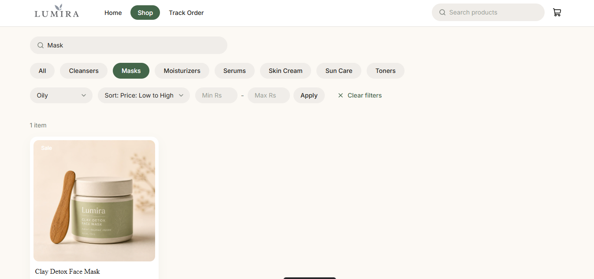
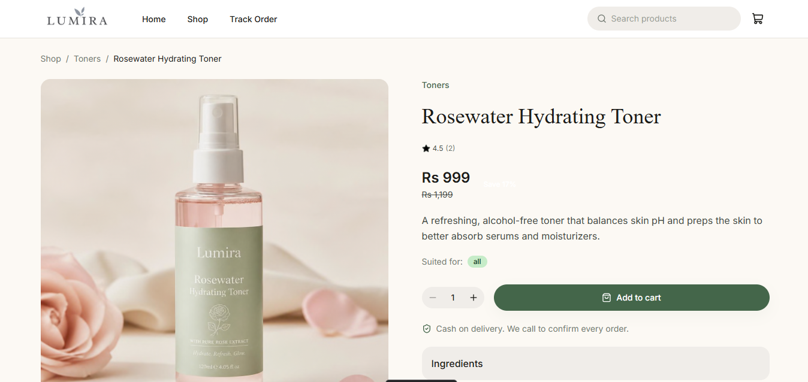
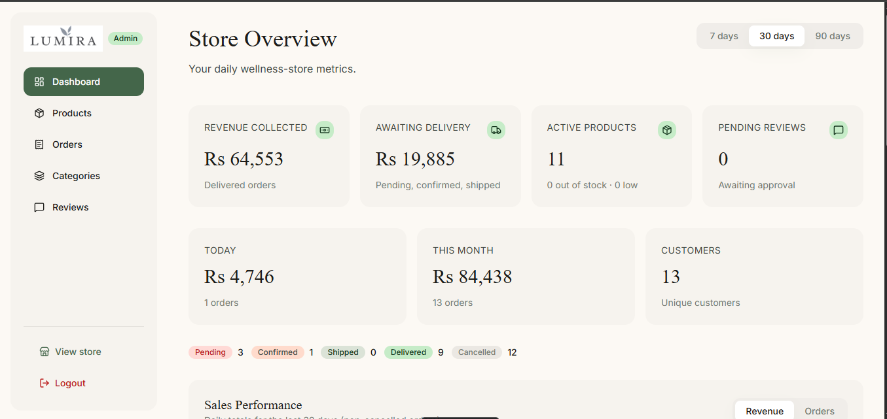
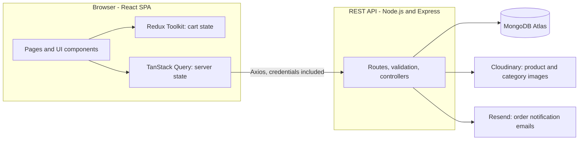
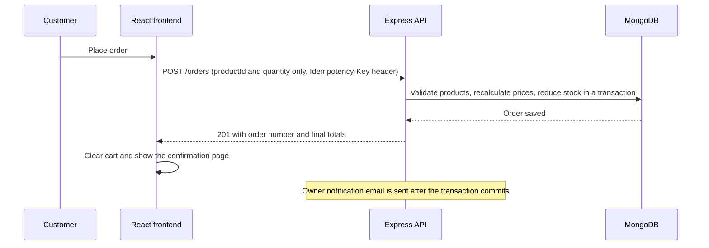

# Lumira - Skincare E-Commerce Store

A full-stack MERN e-commerce application for a skincare brand. Customers can browse products by category, filter and search the catalog, build a cart, check out with Cash on Delivery, and track their orders. Store owners manage orders, products, categories, and customer reviews from a protected admin dashboard.

**Live demo:** [https://lumira-skincare-frontend.vercel.app](https://lumira-skincare-frontend.vercel.app)

**Backend repository:** [https://github.com/Ahsan-Mudassar/Lumira-skincare-backend](https://github.com/Ahsan-Mudassar/Lumira-skincare-backend)

**Author:** Ahsan Mudassar
([GitHub](https://github.com/Ahsan-Mudassar) |
[LinkedIn](https://linkedin.com/in/ahsan-mudassar) |
[Portfolio](https://my-portfolio-mu-six-48.vercel.app/))

> Status: actively developed portfolio project. The sections "Known Limitations" and "Roadmap" list what is still in progress.

---

## Table of Contents

1. [Overview](#overview)
2. [Screenshots](#screenshots)
3. [Tech Stack](#tech-stack)
4. [Architecture](#architecture)
5. [Folder Structure](#folder-structure)
6. [Customer Features](#customer-features)
7. [Product Listing, Filtering, and Categories](#product-listing-filtering-and-categories)
8. [Admin Features](#admin-features)
9. [Responsive Design and Accessibility](#responsive-design-and-accessibility)
10. [Security and Reliability Decisions](#security-and-reliability-decisions)
11. [API Integration](#api-integration)
12. [Getting Started](#getting-started)
13. [Deployment](#deployment)
14. [Known Limitations](#known-limitations)
15. [Roadmap](#roadmap)

---

## Overview

Lumira is built around a clean, premium skincare shopping experience with a natural palette of forest green, sage green, and cream. The goal of the project is to go beyond a visual demo and implement the full purchase workflow: catalog, cart, checkout, order tracking, reviews, and back-office management.

Key characteristics:

- **Guest checkout.** No customer accounts are required. Orders are tracked with an order number and email address.
- **Cash on Delivery.** The store owner is notified by email for every order and confirms it by phone.
- **Backend-validated orders.** The browser sends only product IDs and quantities. Prices, shipping, and stock are always calculated by the API.
- **Cookie-based admin authentication.** The admin dashboard is protected by an httpOnly session cookie.

---

## Screenshots

Add screenshots to `docs/` and keep the paths below, or edit the table to match your file names.

| Shop                                  |                               |
| ------------------------------------------------ | ------------------------------------------ |
|  |  

| Product details                                  |                               |
| ------------------------------------------------ | ------------------------------------------ |
|  |  |

| Product details                                  |                               |
| ------------------------------------------------ | ------------------------------------------ |
|  |  
---

## Tech Stack

**Frontend**

| Area                    | Technology                                                     |
| ----------------------- | -------------------------------------------------------------- |
| UI library              | React 19                                                       |
| Build tool              | Vite                                                           |
| Styling                 | Tailwind CSS v4 with design tokens defined in CSS (`@theme`)   |
| Routing                 | React Router                                                   |
| Client state            | Redux Toolkit (shopping cart)                                  |
| Server state            | TanStack Query (caching, loading and error states, pagination) |
| HTTP client             | Axios                                                          |
| Forms and validation    | React Hook Form with Zod                                       |
| Notifications and icons | react-hot-toast, lucide-react                                  |

**Backend** (separate repository)

| Area                  | Technology                                                |
| --------------------- | --------------------------------------------------------- |
| Runtime and framework | Node.js, Express                                          |
| Database              | MongoDB Atlas with Mongoose                               |
| Authentication        | JWT stored in an httpOnly cookie, bcrypt password hashing |
| Validation            | Zod                                                       |
| File uploads          | Multer with Cloudinary                                    |
| Email                 | Resend (order notifications to the store owner)           |
| Hardening             | helmet, CORS allow-list, rate limiting                    |

---

## Architecture

### System overview



### Checkout flow



### Key design decisions

| Decision                               | Reasoning                                                                                                                                                                                                          |
| -------------------------------------- | ------------------------------------------------------------------------------------------------------------------------------------------------------------------------------------------------------------------ |
| Separate client state and server state | The cart exists only in the browser, so Redux Toolkit manages it and persists it to `localStorage`. Products, orders, and statistics come from the server, so TanStack Query manages their caching and refetching. |
| Feature-based folder structure         | Each feature owns its API calls, hooks, and components. Pages stay thin and only compose features.                                                                                                                 |
| Single API client                      | One Axios instance configures the base URL, credentials, timeout, and error normalization. Components always receive errors in the same shape.                                                                     |
| URL as the source of truth for filters | Shop filters live in the query string, so filtered views can be shared and the browser back button works as expected.                                                                                              |
| Design tokens in CSS                   | Colors, fonts, radii, and shadows are defined once in the Tailwind theme and used through semantic names such as `primary` and `muted`.                                                                            |
| Reusable UI primitives                 | Buttons, inputs, badges, modals, tables, and states live in `components/ui` and are used by both the storefront and the admin area.                                                                                |

### Authentication flow

1. The admin signs in at `/admin/login`. The API sets an httpOnly session cookie.
2. The token is never stored in `localStorage` or Redux. The browser attaches the cookie to every request.
3. The frontend reads the current session from `GET /auth/me` through TanStack Query.
4. `ProtectedRoute` redirects unauthenticated users to the login page. The real enforcement happens on the server for every admin endpoint.
5. Logging out invalidates the session on all devices.

---

## Folder Structure

```text
src/
  App.jsx                    Providers (Redux, TanStack Query, Toaster) and all route definitions
  main.jsx                   Application entry point
  index.css                  Tailwind import and design tokens

  components/
    ui/                      Design-system primitives: Button, Input, Select, Badge, Card, Modal,
                             ConfirmDialog, Table, Pagination, Skeleton, EmptyState, ErrorState, ...
    layout/                  Header, MobileMenu, Drawer, Footer, PublicLayout, AdminLayout, AdminSidebar

  features/
    auth/                    Session hooks and ProtectedRoute
    cart/                    Redux slice, selectors, cart components, add-to-cart button
    categories/              Category API, hook, and category card
    checkout/                Order API, form schema, checkout form, idempotent submit hook
    home/                    Home page sections (hero slider, categories, featured, contact)
    orders/                  Order tracking form, timeline, and order items
    products/                Product API, hooks, filters, gallery, product card
    reviews/                 Review form, rating summary, and review list
    admin/
      dashboard/             Statistics API, hooks, chart, stat cards
      orders/                Orders API, hooks, table
      products/              Product API, hooks, form, stock modal
      categories/            Category API, hooks, form modal
      reviews/               Review moderation API and hooks

  pages/                     Route-level screens
    admin/                   Admin login, dashboard, orders, order detail, products,
                             product form, categories, reviews

  services/                  Axios client, error normalizer, TanStack Query client
  store/                     Redux store with cart persistence
  constants/                 Routes, query keys, order statuses, shipping rules, site content
  lib/                       Formatting, storage, and helper utilities
```

---

## Customer Features

- Home page with a hero slider, category showcase, featured products, and a contact section
- Product listing with category, skin type, price, search, and sort controls
- Product details with an image gallery, discount pricing, quantity selector, ingredients, and customer reviews
- Shopping cart with quantity controls, free-shipping progress, and persistence across page reloads
- Guest checkout with validated form fields and Cash on Delivery
- Order confirmation page and order tracking by order number and email, including a status timeline
- Product reviews that are accepted only after an order has been delivered

---

## Product Listing, Filtering, and Categories

Products are organized into categories. Each category card on the home page links to the shop with that category already applied, and the shop page combines all filters in the URL.

**Supported filters**

| Parameter              | Description                                                               |
| ---------------------- | ------------------------------------------------------------------------- |
| `category`             | Category slug, selected from category chips built from the categories API |
| `skinType`             | Skin type filter                                                          |
| `minPrice`, `maxPrice` | Price range, validated so the minimum cannot exceed the maximum           |
| `search`               | Text search (maximum 50 characters), also available from the header       |
| `sort`                 | `newest`, `price_asc`, `price_desc`, or `name`                            |

**How it works**

- Filters are stored in the query string, for example `/shop?category=serums&sort=price_asc`. The URL can be shared and restored.
- The product list uses TanStack Query's infinite query with a "Load More" button. The API returns pagination metadata (`page`, `totalPages`, `hasNext`) that determines whether more results exist.
- Categories come from the API together with a product count, and an empty or failed state is handled for every list.
- Loading skeletons, empty results, and error states with a retry action are implemented for the shop, home sections, and admin lists.

---

## Admin Features

The admin area is available at `/admin/login` and is protected by cookie-based authentication. There is intentionally no admin link on the public storefront.

| Area       | Capabilities                                                                                                                                                                                                                                                                                                                                                   |
| ---------- | -------------------------------------------------------------------------------------------------------------------------------------------------------------------------------------------------------------------------------------------------------------------------------------------------------------------------------------------------------------- |
| Dashboard  | Revenue collected, revenue awaiting delivery, today and monthly totals, product and low-stock counts, pending reviews, sales chart with 7, 30, and 90 day ranges, trending products, low-stock list, and recent orders                                                                                                                                         |
| Orders     | Filter by status, date range, and order number or phone. Detailed order view with items, customer, shipping address, and status history. Status updates follow the allowed workflow (pending, confirmed, shipped, delivered, cancelled) with an optional note. Cancelling asks for confirmation and restores stock. The owner notification email can be resent |
| Products   | Create products with multiple image uploads, edit product details, update stock by setting a value or adjusting by an amount, and switch a product between active and inactive                                                                                                                                                                                 |
| Categories | Create, edit, and delete categories with image upload. Deleting a category that still contains products is rejected by the API                                                                                                                                                                                                                                 |
| Reviews    | Review moderation with pending, approved, and all views, rating filter, approve, hide, and delete actions                                                                                                                                                                                                                                                      |

**Product status.** An inactive product is hidden from the storefront without deleting its record, so order history and reviews stay intact. The API does not list inactive products publicly and rejects them at checkout.

---

## Responsive Design and Accessibility

The interface is built mobile-first with Tailwind CSS and tested against the design at mobile and desktop widths.

| Area              | Small screens                                                                            | Larger screens                                     |
| ----------------- | ---------------------------------------------------------------------------------------- | -------------------------------------------------- |
| Header            | Logo, cart, and a hamburger button that opens a slide-in menu with search and navigation | Navigation pills from `md`, search field from `lg` |
| Product grids     | Two columns                                                                              | Four columns from `lg`                             |
| Checkout and cart | Single column                                                                            | Two columns from `lg`, with a sticky order summary |
| Admin             | Top bar with a hamburger drawer                                                          | Persistent sidebar from `lg`                       |
| Data tables       | Scroll horizontally inside their own container                                           | Full width                                         |

The mobile experience uses a hamburger menu instead of a bottom navigation bar.

**Accessibility and usability**

- Semantic landmarks, a skip-to-content link, and labelled form fields with `aria-invalid` and `aria-describedby` for errors
- The mobile drawer closes with the Escape key, keeps keyboard focus inside while open, locks page scrolling, and returns focus to the trigger
- The hero slider has a pause control, keyboard and swipe navigation, and respects the reduced-motion preference
- Visible focus indicators and native elements (`dialog`, `select`) where possible
- Images are optimized through Cloudinary transformations, and non-critical images are lazy loaded

---

## Security and Reliability Decisions

- **No client-trusted prices.** Checkout sends only product IDs and quantities. The API recalculates prices, shipping, and stock before saving the order.
- **Idempotent checkout.** Each checkout attempt sends an `Idempotency-Key`. A retry after a network problem returns the original order instead of creating a duplicate.
- **httpOnly cookie sessions.** Authentication tokens are not accessible to JavaScript.
- **No secrets in the frontend.** The only environment variable is the public API URL.
- **Validation on both sides.** Zod and React Hook Form provide immediate feedback in the browser. The API remains the source of truth.
- **Centralized error handling.** Network failures, validation errors, rate limits, and stock conflicts are converted into consistent, readable messages.
- **Defensive local storage.** The persisted cart is sanitized on load, and storage failures do not break the application.

---

## API Integration

The frontend consumes a custom REST API. The main endpoints used are listed below.

| Feature                      | Endpoints                                                                                                                                   |
| ---------------------------- | ------------------------------------------------------------------------------------------------------------------------------------------- |
| Catalog                      | `GET /categories`, `GET /products`, `GET /products/featured`, `GET /products/:slug`                                                         |
| Reviews                      | `GET /products/:slug/reviews`, `POST /reviews`                                                                                              |
| Orders                       | `POST /orders`, `POST /orders/track`                                                                                                        |
| Admin authentication         | `POST /auth/login`, `POST /auth/logout`, `GET /auth/me`                                                                                     |
| Admin orders                 | `GET /admin/orders`, `GET /admin/orders/:id`, `PATCH /admin/orders/:id/status`, `POST /admin/orders/:id/resend-email`                       |
| Admin catalog                | `POST /products`, `PATCH /products/:id`, `PATCH /products/:id/stock`, `DELETE /products/:id`, category create, update, and delete endpoints |
| Admin reviews and statistics | `GET /admin/reviews`, `PATCH /admin/reviews/:id/approval`, `DELETE /admin/reviews/:id`, `GET /admin/stats/*`                                |

---

## Getting Started

### Prerequisites

- Node.js 20 or later
- A running instance of the Lumira backend API

### Installation

```bash
git clone https://github.com/Ahsan-Mudassar/[repository-name].git
cd [repository-name]
npm install
```

### Environment variables

Create a `.env` file in the project root:

```env
VITE_API_URL=http://localhost:5000/api
```

| Variable       | Description                                                                          |
| -------------- | ------------------------------------------------------------------------------------ |
| `VITE_API_URL` | Base URL of the REST API. This value is public because it is bundled into the build. |

The backend must allow the frontend origin through CORS with credentials enabled, and its `CLIENT_URL` must match the exact frontend URL.

### Scripts

| Command           | Description                          |
| ----------------- | ------------------------------------ |
| `npm run dev`     | Start the development server         |
| `npm run build`   | Create a production build in `dist/` |
| `npm run preview` | Preview the production build locally |
| `npm run lint`    | Run ESLint                           |

---

## Deployment

The frontend is a static single-page application and is deployed on Vercel. Because routing happens in the browser, direct visits to paths such as `/admin/login` need a rewrite to `index.html`. Add a `vercel.json` file in the project root:

```json
{
  "rewrites": [{ "source": "/(.*)", "destination": "/index.html" }]
}
```

Set `VITE_API_URL` in the Vercel project settings and redeploy after changing it, because Vite embeds environment variables at build time.

When the frontend and API are hosted on different domains, the admin session cookie must be configured for cross-site use (`SameSite=None` and `Secure`). Alternatively, proxy the API through the frontend domain so the cookie stays first-party.

---

## Known Limitations

- The admin product list currently uses the public product endpoint, so it shows active products only and may not show exact stock. A dedicated admin product endpoint is planned.
- The contact form on the home page opens the visitor's email client, because the backend has no contact-message endpoint.
- Testimonials on the home page are sample content.
- Shipping rules used for cart estimates are mirrored in the frontend. The final amounts always come from the API.
- Automated tests are not yet implemented.

---

## Roadmap

- Dedicated admin product listing and detail endpoint with inactive products, stock, and SKU
- Product activation toggle with clear status indicators, consistent backend enforcement, and checkout protection for inactive products
- Product image replacement in the edit form
- Automated tests for critical flows (cart logic, checkout, route guards)
- Performance work: route-level code splitting and image optimization audit
- Accessibility audit and SEO improvements
- Online payment integration

---

## License

This project is a personal portfolio project. Add a license of your choice before accepting external contributions.
